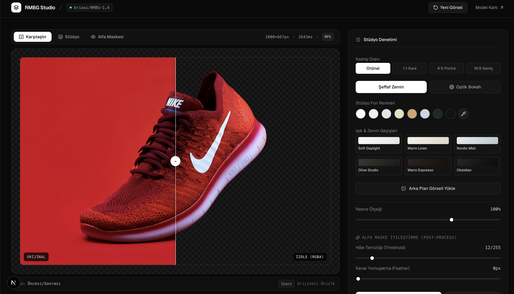
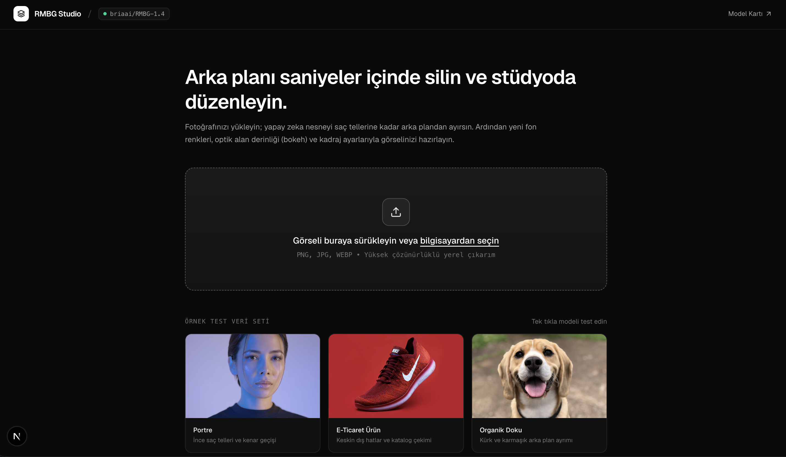
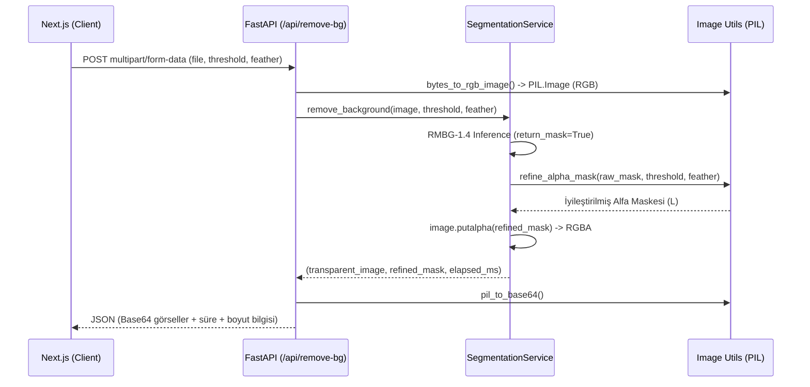

# RMBG Studio

**Canlı Uygulama (Frontend - Vercel):** [https://rmbg-studio.vercel.app](https://rmbg-studio.vercel.app)  
**Canlı AI Servisi (Backend - Modal Serverless):** [https://tunahanbucak--rmbg-studio-api-fastapi-app.us-east.modal.run/docs](https://tunahanbucak--rmbg-studio-api-fastapi-app.us-east.modal.run/docs)

Hugging Face üzerindeki **`briaai/RMBG-1.4`** modelini kullanarak fotoğrafların arka planını ayıran (`Alpha Matting`), kenar iyileştirmesi (`Post-Processing`) yapan ve tarayıcı üzerinde arka plan/ışık düzenlemesi sunan Full-Stack (FastAPI + Next.js) web uygulaması.

Derin öğrenme eğitimim kapsamında, hazır bir Hugging Face modelini gerçek bir ürün mimarisiyle servis etmek amacıyla geliştirilmiştir.





---

## Proje Özeti ve Mimari Yaklaşım

Görüntü sınıflandırma (*Classification*) veya nesne tespiti (*Object Detection*) modellerinden farklı olarak, arka plan silme işlemi piksel düzeyinde bölütleme (*Dichotomous Image Segmentation*) gerektirir. Bu projede hem modelin Python tarafında verimli servis edilmesine hem de Next.js tarafında elde edilen çıktının gerçek bir fotoğraf stüdyosu gibi işlenebilmesine odaklandım:

- **Singleton Model Yükleme & GPU Hızlandırma:** Model her API isteğinde tekrar yüklenmez. Sunucu ayağa kalkarken `SegmentationService` içinde tek sefer belleğe alınır. Apple Silicon Mac cihazlarda `MPS`, NVIDIA kartlarda `CUDA`, aksi halde `CPU` otomatik seçilir.
- **Tek Seferlik Çıkarım (Single-Pass Inference):** `transformers.pipeline` fonksiyonuna `return_mask=True` verilerek model yalnızca 1 kez çalıştırılır ve 8-bitlik (`0-255`) olasılık maskesi alınır. Bu maske hem "Alfa Maskesi" sekmesinde görselleştirilir hem de `putalpha()` ile orijinal RGB görüntüye 4. kanal olarak eklenir.
- **Bellek İçi (In-Memory) Görüntü İşleme:** Yüklenen ve üretilen görseller diske kaydedilmeden `io.BytesIO` üzerinden RAM'de işlenir ve Base64 formatında istemciye döndürülür.
- **Maske İyileştirme (Post-Processing):** Modelin nesne sınırlarında bırakabildiği düşük olasılıklı gri pikseller (koyu zeminlerde oluşan beyaz hâle/halo izleri), 256 elemanlı Lookup Table (`LUT`) eşiklemesi ve opsiyonel `GaussianBlur` kenar yumuşatması ile temizlenir.

---

## Veri Akışı



---

## Temel Özellikler

### Backend (FastAPI & PyTorch)
- `briaai/RMBG-1.4` (IS-Net mimarisi) ile arka plan ayrıştırma.
- **Hâle Temizliği (`Threshold`):** Belirlenen eşik değerinin (`0-120`) altındaki zayıf alfa piksellerini sıfırlama.
- **Kenar Yumuşatma (`Feather`):** Kesim sınırlarına `0px - 4px` aralığında Gauss bulanıklığı uygulama.

### Frontend (Next.js, TypeScript, Tailwind CSS, HTML5 Canvas)
- **Öncesi / Sonrası Karşılaştırma (`CompareSlider`):** CSS `clip-path: inset(...)` kullanarak orijinal fotoğraf ile kesilmiş çıktıyı 60 FPS kıyaslama.
- **Alfa Maskesi Görünümü:** Modelin ürettiği siyah-beyaz olasılık haritasını doğrudan inceleme.
- **Stüdyo Kompozisyonu:**
  - Şeffaf zemin, editoryal fon renkleri, yumuşak ışık geçişleri, özel arka plan yükleme ve **Optik Bokeh** (orijinal arka planı bulanıklaştırıp net ön planla birleştirme).
  - `Orijinal`, `1:1 Kare`, `4:5 Portre` ve `16:9 Geniş` kadraj oranları.
  - Nesneyi sahne üzerinde fare/dokunmatik ile sürükleyip konumlandırma, ölçeklendirme, döndürme, yatay aynalama (`Flip`), dış kontur çizgisi (`Sticker Outline`) ve parlaklık/kontrast/doygunluk ayarları.
  - `Space` tuşuna basılı tutarak anlık orijinal fotoğrafı önizleme ve oturum geçmişi (`History Filmstrip`) ile önceki görsellere tek tıkla dönme.
- **Çok Katmanlı `<canvas>` Çıktısı & Pano Desteği:** Ekranda yapılan tüm düzenlemeleri orijinal çözünürlükte HTML5 Canvas üzerinde birleştirerek **PNG olarak indirme** veya `ClipboardItem` API'si ile doğrudan **panoya kopyalama (`Cmd+V`)**.

---

## Klasör Yapısı

```text
AIBackgroundStudio/
├── backend/
│   ├── app/
│   │   ├── config.py               # Model ID, MPS/CUDA/CPU tespiti ve CORS ayarları
│   │   ├── schemas.py              # Pydantic yanıt şemaları
│   │   ├── routers/
│   │   │   └── background.py       # /api/health ve /api/remove-bg endpoint'leri
│   │   ├── services/
│   │   │   └── segmentation.py     # RMBG-1.4 model yükleme ve çıkarım servisi
│   │   └── utils/
│   │       └── image.py            # BytesIO, LUT eşikleme, Gaussian Blur ve Base64
│   ├── Dockerfile                  # Konteyner dağıtım yapılandırması
│   ├── modal_app.py                # Modal.com Serverless (4 vCPU / 4 GB RAM) bulut dağıtım dosyası
│   ├── main.py                     # FastAPI uygulama giriş noktası
│   └── requirements.txt            # Python paket bağımlılıkları (PyTorch & Transformers)
│
├── frontend/
│   ├── app/                        # Next.js App Router (layout, page, globals.css)
│   ├── components/
│   │   ├── layout/Header.tsx       # Üst bar
│   │   ├── upload/                 # Dropzone ve örnek görsel galerisi
│   │   └── studio/                 # CanvasToolbar, CompareSlider, StudioStage, InspectorPanel, HistoryFilmstrip
│   ├── constants/studio-presets.ts # Sabit renk, gradyan ve örnek görsel tanımları
│   ├── hooks/useStudio.ts          # Tüm stüdyo state'ini ve kısayolları yöneten Custom Hook
│   ├── services/api.ts             # FastAPI istemci fonksiyonları
│   ├── types/studio.ts             # TypeScript veri tipleri
│   └── utils/canvas-exporter.ts    # HTML5 Canvas katman birleştirme ve dışa aktarma motoru
│
└── package.json                    # Geliştirme çalıştırma kısayolları
```

---

## Kurulum ve Çalıştırma

### 1. Backend Kurulumu
```bash
cd backend
python3 -m venv .venv
source .venv/bin/activate
pip install -r requirements.txt
```
*(İlk çalıştırmada `briaai/RMBG-1.4` model ağırlıkları Hugging Face üzerinden otomatik olarak indirilir.)*

### 2. Frontend Kurulumu
```bash
cd frontend
npm install
```

### 3. Geliştirme Sunucularını Başlatma
Proje ana dizinindeyken iki ayrı terminalde çalıştırabilirsiniz:

```bash
# Terminal 1 - FastAPI Backend (http://localhost:8000)
npm run dev:backend

# Terminal 2 - Next.js Frontend (http://localhost:3000)
npm run dev:frontend
```

---

## API Endpoint'leri

### `GET /api/health`
Sunucu durumunu ve aktif donanım hızlandırıcısını (`MPS`, `CUDA`, `CPU`) döner.

### `POST /api/remove-bg`
`multipart/form-data` formatında görüntü ve opsiyonel maske parametrelerini alır:
- `file` *(UploadFile)*: İşlenecek görüntü dosyası.
- `threshold` *(int, varsayılan: `12`)*: Hâle temizliği eşik değeri (`0 - 250`).
- `feather` *(float, varsayılan: `0.0`)*: Kenar yumuşatma yarıçapı (`0.0 - 10.0`).
